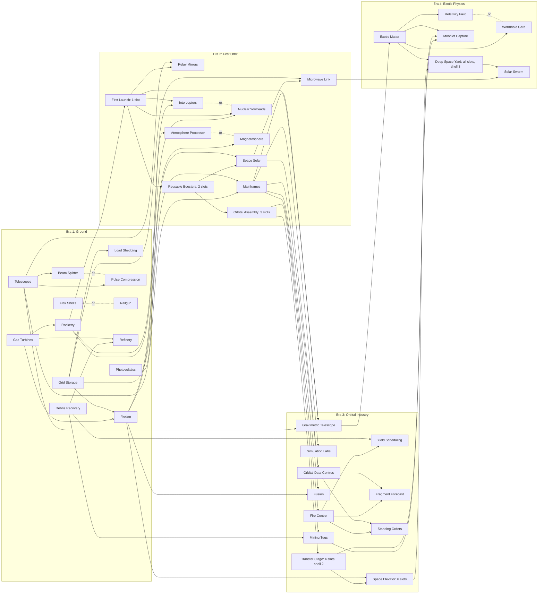

# Astro Defender: tech tree design

Status: superseded first draft, kept for its reasoning. The tree that is implemented lives in
`engine/src/tree/core.ts` and differs from this document in resources and cards.

Original status: proposal. Nothing here is implemented or balanced yet. All numbers are first guesses to be
tuned with the bot in `engine/src/bot.ts`. No simulation was run for this document.

Short version:

- Four eras: **Ground**, **First Orbit**, **Orbital Industry**, **Exotic Physics**. 41 techs.
- Each era's techs need a resource chain the previous era did not have: power, then volatiles, then
  compute, then exotics.
- Three materials: **metal**, **volatiles**, **exotics**. Power and compute are capacities, not stockpiles.
- Compute is a second grid. It runs programs: trajectory plots, fire control, yield scheduling,
  fragment forecasts, automation and research.
- Five either/or pairs. One orbital-slot line: 1, 2, 3, 4, 6, then all slots.
- The big tree is researched inside a run. The permanent tree is small and gives options, not stats.

---

## 1. Lessons from other games

Each lesson says what it changes in this design. Source strength is marked: **[dev]** is a developer
post, **[wiki]** a community wiki or mod page, **[essay]** a signed design article, **[weak]** forum
posts, fan guides, store pages or search summaries where the primary page could not be opened.

1. **A new tier must demand a new production chain, not a bigger number.** Factorio's Chemical pack
   is the point where oil enters; the developers called it the largest complexity step and smoothed
   it rather than removing it. Here: each era's techs cost something the previous era did not
   produce. [dev] [FFF-275](https://factorio.com/blog/post/fff-275)
2. **A choice the player does not notice is not a choice.** Factorio's Production and High-tech
   packs were meant as alternatives, but "most players don't even realize" it. Here: either/or
   branches are shown as a pair on one card, never as two unrelated nodes.
   [dev] [FFF-275](https://factorio.com/blog/post/fff-275)
3. **Cut prerequisites that only exist to slow the player.** Factorio removed the rocket-speed
   upgrade from the rocket silo's requirements because nothing justified it. Here: every
   prerequisite is something the tech physically builds on.
   [dev] [FFF-275](https://factorio.com/blog/post/fff-275)
4. **Break the move to space into small steps that each pay off.** Space Age moved the silo earlier
   and split space into stages to "break this into smaller manageable sub-parts". Here: one orbital
   slot first, and that one slot must already be worth having.
   [dev] [FFF-381](https://factorio.com/blog/post/fff-381)
5. **In space, power costs room.** On a Space Age platform every solar panel adds size and weight.
   Here: orbital power costs orbital slots, which are the scarcest thing in the game.
   [dev] [FFF-381](https://factorio.com/blog/post/fff-381)
6. **Asteroid type decides the resource.** Space Age: metallic chunks give iron, carbonic give
   carbon, oxide give ice. Big asteroids break into smaller ones when shot. Here: iron gives metal,
   ice comets give volatiles, dark bodies give exotics.
   [wiki] [Factorio wiki: Space platform](https://wiki.factorio.com/Space_platform)
7. **Orbit should have its own rules.** Space Age bans robots and chests on platforms to keep the
   puzzle. Here: orbit has its own power grid until the player links it to the ground.
   [dev] [FFF-381](https://factorio.com/blog/post/fff-381)
8. **Some things are only made in space, and beamed energy has a price.** Space Exploration requires
   space science to be made in orbit, and its energy beams weaken with distance. Here: the good
   compute source is orbital, and the ground-orbit power link has a capacity.
   [wiki] [Space Exploration mod page](https://mods.factorio.com/mod/space-exploration)
9. **Late tiers each need one named rare resource.** Space Exploration ties each specialist science
   to one material (iridium, beryllium, holmium, vitamelange). Here: the last era runs on exotics.
   [wiki] [Space Exploration mod page](https://mods.factorio.com/mod/space-exploration)
10. **The energy megaproject sits outside the normal building grid and feeds research.** In Dyson
    Sphere Program the swarm and sphere are built around the star, and ray receivers turn that
    energy into power or into the photons the last research needs. Here: the solar swarm grows off
    the slots, and power turns into research through labs and compute.
    [weak] [gamepressure guide](https://www.gamepressure.com/dyson-sphere-program/technologies/zfe1cf),
    [dyson-calculator](https://dyson-calculator.com/en/items/detail/id/E_Matrix/name/Energy+Matrix).
    The two sources disagree on the Energy Matrix recipe; the official wiki blocked access.
11. **A tech should unlock a complete, usable thing.** Kerbal players complain that parts used
    together are scattered over distant nodes and that science is a generic currency unrelated to
    what it buys. Here: a slot tech always comes with something to put in the slot, and costs use
    the resource the tech is about.
    [weak, player opinion] [KSP forum](https://forum.kerbalspaceprogram.com/topic/105543-career-mode-progression-and-game-design-analysis),
    [KSP forum](https://forum.kerbalspaceprogram.com/topic/144444-the-tech-tree-progression-is-ridiculous/page/6)
12. **Reward often, and show less at once.** Civilization "always giv[es] the player something they
    want within a couple of turns", but its full tree is front-loaded complexity and, being static,
    gets memorised. Here: a level shows only its own pool of about ten techs.
    [essay] [Murthy, Techs of Civilization, 2018](https://www.gamedeveloper.com/design/techs-of-civilization)
13. **Drafted research makes runs differ but hurts planning.** Stellaris offers a few weighted
    options instead of a tree so each game is "a new and different journey". Critics call it too
    random, and Murthy finds it weaker for long-term planning. Here: draft from a pool the player
    can see in full, with a rule that a skipped tech must return.
    [weak] [Stellaris dev diary 11 thread](https://forum.paradoxplaza.com/forum/developer-diary/stellaris-dev-diary-11-research-technology.893377/)
    (the page did not load; this rests on search excerpts),
    [essay] [Murthy](https://www.gamedeveloper.com/design/techs-of-civilization)
14. **Pay for research in the thing itself.** Mindustry research is instant and costs the materials
    involved, and some nodes require capturing a sector. Here: tech costs include materials, so a
    tech cannot be bought before its resource has been met in play.
    [weak] [Steam discussion](https://steamcommunity.com/app/1127400/discussions/0/2992045158717932150),
    [itch.io comments](https://anuke.itch.io/mindustry/comments?after=1189)
15. **A permanent tree in a tower defence should be small, resettable and capped.** Kingdom Rush has
    6 trees of 5 tiers, 65 stars in total, a free reset, and caps tree levels on early challenge
    stages. Its better nodes change a rule (Salvage: selling returns 90% instead of 60%).
    [wiki] [Kingdom Rush upgrades](https://wikily.gg/kingdom-rush/upgrades)
16. **Let players switch permanent bonuses off.** Bloons TD 6 lets players disable Monkey Knowledge
    and disables it in CHIMPS mode. One user review says maxing it takes 300+ hours, which reads as
    grind. Here: the permanent tree is short and can be turned off.
    [weak] [Bloons wiki](https://www.bloonswiki.com/Monkey_Knowledge_(BTD6)) (search excerpts only)
17. **Permanent progress should widen the pool, not raise the numbers.** Rogue Tower's run cards
    unlock and upgrade towers; experience between runs unlocks more cards to appear.
    [weak, store page] [Rogue Tower on Steam](https://store.steampowered.com/app/1843760/Rogue_Tower)
18. **Give each resource one clear job.** Dome Keeper: iron buys upgrades, water runs gadgets,
    cobalt repairs. Here: metal builds, volatiles launch and burn, exotics bend physics.
    [wiki] [Dome Keeper wiki: Resources](https://domekeeper.wiki.gg/wiki/Resources)
19. **An interesting choice is different, balanced, clear and limited.** If one option dominates
    "there's no real choice there"; too many options cause paralysis. Here: three cards per pick.
    [essay] [Doucet, Upgrades, Equipment, and Skill Trees, 2011](https://www.gamedeveloper.com/design/upgrades-equipment-and-skill-trees)
20. **Permanent techs are ratchets.** Harkins: a tech tree orders options and gates content, but
    what is learned can never be lost, so keep permanent advances to low-power sinks and let players
    respecialise. Here: power lives in the run; the permanent tree resets for free.
    [essay] [Harkins, Technology Trees, 2009](https://push.cx/technology-trees)
21. **Research goes stale when income outgrows cost.** Cliffski: late research becomes trivial, and
    a skipped branch is bought with "click click click". Raising prices alone herds players to cheap
    techs first. Here: later eras need a different resource, not just more science.
    [dev blog] [Cliffski, 2017](https://www.positech.co.uk/cliffsblog/?p=4608)
22. **Small percentage nodes are felt as filler.** Players of large passive trees say it takes
    dozens of points before anything changes. Here: no tech is a bare percentage.
    [weak, forum] [Path of Exile 2 discussion](https://steamcommunity.com/app/2694490/discussions/0/830448456536473009)

Considered and not adopted: Civilization 6 style boosts (doing a thing discounts its tech). It is a
good idea, but it needs a new trigger system in the engine. Revisit after the tree works.

---

## 2. Resource model

### Materials (stockpiles)

| Material | Comes from | Spent on | Scarce when |
|---|---|---|---|
| **Metal** | Iron asteroids (rich), rock (normal), rubble piles (poor), alien wrecks, wave rewards | Every structure. Cannon shells are free; rocket bodies and nukes cost metal per shot. | Always a little. It is today's `minerals`. |
| **Volatiles** | Ice comets (rich), rubble piles (poor) | Launch fuel for every orbital build, rocket shots, gas turbine and fusion fuel, the atmosphere processor | From First Orbit on. Launches, rockets and turbines compete. |
| **Exotics** | Dark bodies and alien wrecks, only after `exoticMatter` | Exotic Physics techs and structures, each wormhole jump | The whole last era. |

Why these three. Metal and volatiles map to the asteroid types the game already has. They also make
the break-or-burn rule matter twice: vaporizing an ice comet with a laser is easy but halves the
volatiles. Exotics arrive late, so the early game has one material, the middle game two and the late
game three. A third common material from the start was rejected: three stockpiles on a phone in
level one is too much.

Yield per unit of mass, first pass:

| Body | Metal | Volatiles | Exotics | Note |
|---|---|---|---|---|
| Rock | 1 | 0 | 0 | The baseline |
| Iron | 2 | 0 | 0 | Resists heat |
| Ice comet | 0.2 | 1.5 | 0 | Weak to heat, burns fast in atmosphere |
| Rubble pile | 0.6 | 0.3 | 0 | Shatters into many fragments |
| Dark body | 0.5 | 0 | 1 | Lasers barely touch it; hard to see |
| Alien ship | 1 | 0 | 0.5 | Shoots at structures |

### Capacities (rates, not stockpiles)

- **Power.** As today: generation plus batteries against demand; a shortfall scales everything.
- **Compute.** A second grid with the same rule. Data centres turn power into compute. Programs draw
  compute. If programs want more than there is, all of them degrade by the same share.
- **Technology.** This is the research currency. The engine calls it `science`; the UI can call it
  Technology. Labs turn power into it. Compute that no program is using also turns into it once
  `simulationLabs` is researched.

So the chain is: materials build generators, generators make power, power runs labs and data
centres, data centres make compute, and power and compute make technology. That is the owner's
ladder: basic resources, energy, then compute and technology.

### What an era's techs cost

| Era | Cost | What that forces |
|---|---|---|
| 1 Ground | Science | A lab and the power to run it |
| 2 First Orbit | Science + volatiles | Killing ice comets without vaporizing them |
| 3 Orbital Industry | Science + a minimum of installed compute | Data centres and the power for them |
| 4 Exotic Physics | Science + exotics | Finding and killing dark bodies and alien ships |

The compute requirement is a threshold on installed capacity. It is not consumed.

### What the player is short of

| Stage | Short of | Typical decision |
|---|---|---|
| Ground, early | Power | A third laser, or a plant so the first two fire at full strength? |
| Ground, late | Surface slots and night power | Lab or weapon? Solar with batteries, or a turbine that burns volatiles? |
| First Orbit | Volatiles and orbital slots | Launch a mirror now, or keep the fuel for rockets this wave? |
| Orbital Industry | Compute and orbital power in shadow | Fire control during the wave, research between waves |
| Exotic Physics | Exotics and peak power | One wormhole jump empties the batteries. Which rock deserves it? |

---

## 3. The tree

Reading the tables:

- **Cost**: S is science, M metal, V volatiles, X exotics, C installed compute needed (not spent).
- **Requires**: all listed techs.
- A row marked **OR** is half of an either/or pair. Taking one locks the other for the rest of the run.
- Structures available with no tech: coal plant, laser, cannon, lab.

Weapon roles and blind spots, for reference:

| Weapon | Job | Blind spot |
|---|---|---|
| Laser (thermal) | Clean kills, no fragments, instant hit | Heavy power draw, weak on iron and dark bodies, halves yield, stops at the horizon |
| Cannon (kinetic) | Cheap, shatters, pushes bodies back out | Makes fragments someone must handle, short range |
| Rockets (explosive) | Long range, area damage | Every shot costs metal and volatiles |

### Era 1: Ground (planet only)

| Id | Name | Effect | Requires | Cost | What changes in play |
|---|---|---|---|---|---|
| `photovoltaics` | Photovoltaics | Unlocks the solar farm: strong, free, daylight only | none | 20 S | Slot position now matters for power. Night becomes a problem. |
| `gridStorage` | Grid Storage | Unlocks batteries. The HUD shows seconds of reserve. | none | 25 S | The player can overbuild weapons and ride out peaks and nights. |
| `combustion` | Gas Turbines | Unlocks the gas turbine: strong constant power that burns volatiles | none | 30 S | Power can be bought with comets. Ice becomes worth shattering instead of burning. |
| `smartGrid` | Load Shedding | The player sets a priority per structure. In a shortfall, low priority loads switch off first instead of everything dimming. | `gridStorage` | 40 S | Labs can be sacrificed to keep lasers at full strength. A new control, not a number. |
| `fission` | Fission | Unlocks the fission plant: large constant power, costs much metal, takes a surface slot | `combustion`, `gridStorage` | 90 S + 40 M | Ends the night problem on the ground. Gate for planetary engineering and fusion. |
| `optics` | Telescopes | Unlocks the observatory. Shows the next wave's bodies and entry angles during the build phase. Weapons in the two neighbouring slots gain range. | none | 25 S | The player places defences where the wave will come in. |
| `rocketry` | Rocketry | Unlocks the rocket battery: long range, explosive, each shot costs metal and volatiles | `combustion` | 45 S | A weapon that spends the stockpile. Toggling it off is a real decision. |
| `beamSplitter` | Beam Splitter (**OR A**) | Each laser hits two targets at half strength each | `optics` | 40 S | Lasers become the answer to fragment clouds. |
| `pulseCompression` | Pulse Compression (**OR A**) | Lasers store energy and fire short bursts that crack iron as if kinetic. Draw comes in spikes. | `optics` | 40 S | Lasers answer iron, but need batteries to feed the spikes. |
| `flakShells` | Flak Shells (**OR B**) | Cannon shots burst in an area and shatter bodies into more, smaller fragments | none | 35 S | Pairs with atmosphere: small fragments burn up. Bad high above the air. |
| `railgun` | Railgun (**OR B**) | Replaces the cannon with the railgun: long range, heavy knockback, charges from the grid | none | 35 S | Kinetic at range, and a way to shove one big rock back out. Adds power draw. |
| `salvage` | Debris Recovery | Unlocks the salvage yard. Fragments that burn up over its part of the sky pay out instead of being lost. | none | 30 S | Shatter, let the air finish them, collect. The first economy combo. |
| `refining` | Refinery | Unlocks the refinery: converts metal to volatiles or back at a loss, using power | `salvage`, `combustion` | 45 S | A wave with no comets no longer strands a rocket build. A partial fix, never a full one. |

### Era 2: First Orbit

Every orbital build also costs launch fuel in volatiles until `spaceElevator`.

| Id | Name | Effect | Requires | Cost | What changes in play |
|---|---|---|---|---|---|
| `firstLaunch` | First Launch | **1 orbital slot** in the lowest shell. Unlocks the telescope satellite (the observatory, but it sees the whole sky). | `rocketry` | 60 S + 30 V | The first structure that moves over the horizon. Which slot to use is a choice. |
| `mirrors` | Relay Mirrors | Unlocks the mirror satellite. Surface lasers can fire at any body the mirror can see. | `firstLaunch`, `optics` | 50 S + 10 V | Lasers reach past the horizon with ground power. The one slot is worth having. |
| `launchCadence` | Reusable Boosters | **2 orbital slots** | `firstLaunch` | 80 S + 40 V | Two satellites can work as a pair. |
| `spaceSolar` | Space Solar | Unlocks the orbital solar array and the orbital grid. Orbital structures draw only orbital power. | `launchCadence`, `photovoltaics` | 70 S + 30 V | Lasers and cannons now work in orbit, if an array feeds them. Shadow replaces night. |
| `orbitalAssembly` | Orbital Assembly | **3 orbital slots** | `launchCadence` | 110 S + 60 V | Room for array, weapon and one support satellite. |
| `beamedPower` | Microwave Link | Unlocks the rectenna on a surface slot. Each rectenna joins the two grids up to a fixed capacity. | `spaceSolar`, `gridStorage` | 100 S + 30 V | Orbital solar runs the ground at night. A fission plant runs orbital lasers. Costs a surface slot. |
| `interceptors` | Interceptors (**OR C**) | Rocket batteries fire fast, cheap, homing missiles with no blast | `rocketry`, `firstLaunch` | 70 S + 30 V | Rockets become the answer to fragments and alien ships. |
| `nuclearWarheads` | Nuclear Warheads (**OR C**) | Rocket batteries carry one nuke each, fired by hand. Huge blast. Bodies inside pay no materials. Your own satellites in the blast go dark for a few seconds. | `rocketry`, `firstLaunch` | 90 S + 40 V + 40 M | A panic button with three costs: ammo, lost yield and blinded satellites. |
| `thickAtmosphere` | Atmosphere Processor (**OR D**) | Unlocks a surface structure that burns volatiles to raise the atmosphere while switched on | `fission` | 100 S + 50 V | Small debris burns higher up. Big rocks come down sooner. Surface solar and laser range drop. A switch the player flips per wave. |
| `magnetosphere` | Magnetosphere (**OR D**) | Unlocks a surface structure that draws heavy power. Iron bodies sink more slowly and alien shots are deflected. | `fission` | 100 S + 60 M | Buys time against iron and ships. Does nothing to rock, ice or dark bodies. |
| `computing` | Mainframes | Unlocks the ground data centre (little compute, much power) and the first program, **Trajectory Plot** | `optics`, `gridStorage` | 80 S + 20 V | The player sees each body's full path, impact point and time. See the compute section. |

### Era 3: Orbital Industry

| Id | Name | Effect | Requires | Cost | What changes in play |
|---|---|---|---|---|---|
| `fireControl` | Fire Control | Program. The player gives each weapon a rule: lowest, heaviest, richest, or "do not shatter above this line". Weapons stop wasting shots on the same target. | `computing` | 100 S, 10 C | Towers do what the player means. The either/or weapon choices pay off more. |
| `orbitalDataCentres` | Orbital Data Centres | Unlocks the orbital data centre: four times the compute of the ground one, runs on orbital power | `computing`, `spaceSolar` | 130 S, 10 C | Compute moves to space. It stops in the planet's shadow unless batteries or a link cover it. |
| `simulationLabs` | Simulation Labs | Program. Compute that no other program is using becomes science. | `computing` | 110 S, 20 C | Between waves all compute researches. During waves the player trades research for aim. |
| `yieldScheduling` | Yield Scheduling | Program. Weapons hold fire until a body is as low as the plot says is still safe, then kill it. | `fireControl`, `salvage` | 120 S, 20 C | More materials from the same wave. If power dips, "safe" stops being safe. |
| `fragmentForecast` | Fragment Forecast | Program. Before a kinetic or explosive hit, the screen shows where the fragments will go and which will burn. | `fireControl`, `orbitalDataCentres` | 140 S, 40 C | Fragmentation becomes something the player plans instead of something that happens. |
| `autonomy` | Standing Orders | Program. Hand-fired tools (nukes, wormholes, atmosphere switch) fire themselves at the moment the plot rates best. | `fireControl`, `orbitalDataCentres` | 180 S, 60 C | Frees the player's thumbs late in the game. Costs the most compute of any program. |
| `highOrbit` | Transfer Stage | **4 orbital slots** and access to the **second shell** | `orbitalAssembly` | 150 S + 60 V, 10 C | Slow, wide-view slots. Good for telescopes, mirrors and arrays; poor for short-range weapons. |
| `spaceElevator` | Space Elevator | **6 orbital slots**. Orbital builds stop costing launch fuel. | `highOrbit`, `fission` | 220 S + 150 M, 20 C | Volatiles are freed for rockets, turbines and fusion. Rebuilding in orbit becomes cheap. |
| `fusion` | Fusion | Unlocks the fusion plant: very large constant power, sips volatiles | `fission`, `computing` | 200 S + 60 V, 40 C | Enough power for fields and wormholes. Keeps volatiles relevant to the end. |
| `orbitalMining` | Mining Tugs | Unlocks the tug satellite. It captures fragments below a mass limit whole, for full yield. | `salvage`, `orbitalAssembly` | 130 S, 10 C | Shattering high up becomes profitable. A slot spent on income instead of defence. |
| `gravimetry` | Gravimetric Telescope | Telescope satellites show dark bodies fully. All weapons can target them at full range. | `optics`, `firstLaunch`, `computing` | 120 S, 20 C | Without it, dark bodies are a shimmer that weapons only engage up close. |

### Era 4: Exotic Physics

| Id | Name | Effect | Requires | Cost | What changes in play |
|---|---|---|---|---|---|
| `exoticMatter` | Exotic Matter | Dark bodies and alien wrecks now pay exotics | `gravimetry` | 200 S, 40 C | The worst enemies become the most wanted. Opens the last era. |
| `relativityField` | Relativity Field (**OR E**) | Unlocks the field generator: time runs slower for bodies inside its zone | `exoticMatter` | 250 S + 30 X | A slow tower. Constant heavy draw. Everything else gets more shots. |
| `wormholes` | Wormhole Gate (**OR E**) | Unlocks the gate. On command it sends one body back to a high orbit. Each jump costs exotics and a large burst of power. | `exoticMatter` | 250 S + 30 X | A second chance at one rock. Needs full batteries. The rock comes back. |
| `moonCapture` | Moonlet Capture | Unlocks the tractor. It parks one heavy body in a shell slot as a moonlet. The moonlet bends nearby orbits, absorbs hits and can be mined by tugs. | `orbitalMining`, `highOrbit`, `exoticMatter` | 280 S + 40 X | A boss rock becomes terrain. It fills a slot for good. |
| `deepSpaceYard` | Deep Space Yard | **All orbital slots** and access to the **third shell** | `spaceElevator`, `exoticMatter` | 300 S + 20 X | The full atom. The limit is now power and compute, not slots. |
| `solarSwarm` | Solar Swarm | Unlocks the swarm relay in the third shell. Its output grows for as long as it survives. Power reaches the grids only through rectennas. | `beamedPower`, `deepSpaceYard` | 320 S + 30 X | Power that grows without more slots. The earlier it is built, the more it gives. Capped by link capacity. |

Total: 13 + 11 + 11 + 6 = 41 techs.

### The lines, read across eras

- **Energy:** coal (start) → `photovoltaics` / `combustion` → `gridStorage` → `smartGrid` → `fission` →
  `spaceSolar` → `beamedPower` → `fusion` → `solarSwarm`.
- **Orbital slots:** `firstLaunch` (1) → `launchCadence` (2) → `orbitalAssembly` (3) → `highOrbit` (4, shell 2)
  → `spaceElevator` (6, free launches) → `deepSpaceYard` (all, shell 3). The cap counts structures in
  orbit at once. The player chooses which of the level's slots to use.
- **Weapons and tools:** laser and cannon (start) → OR A, OR B → `rocketry` → `mirrors` → OR C → OR D →
  OR E → `moonCapture`.
- **Economy and mining:** `salvage` → `refining` → `orbitalMining` → `yieldScheduling` → `exoticMatter` →
  `moonCapture`.
- **Sight:** `optics` → telescope satellite (`firstLaunch`) → `gravimetry`.
- **Compute:** `computing` → `fireControl`, `simulationLabs` → `orbitalDataCentres` → `yieldScheduling`,
  `fragmentForecast` → `autonomy`.

### What compute does

Compute is a second grid. Data centres supply it. Programs draw it while switched on. The player
switches programs on and off; when demand exceeds supply, every program degrades by the same share,
exactly like power.

| Program | Draw | At full compute | Degraded |
|---|---|---|---|
| Trajectory Plot | 5 | Every body shows its full remaining path, impact point and time to impact | The plot shortens to the next lap |
| Fire Control | 10 | Per-weapon target rules, no double targeting | Weapons fall back to "nearest" part of the time |
| Yield Scheduling | 15 | Weapons wait for the lowest safe kill | The safety margin widens, so kills happen higher and pay less |
| Fragment Forecast | 20 | Fragment paths drawn before the shot | Only the largest fragments are drawn |
| Standing Orders | 30 | Hand-fired tools trigger themselves at the best moment | Triggers come late |
| Simulation Labs | all spare | Spare compute becomes science | Less spare, less science |

Why this is fun rather than bookkeeping:

- The reward is on screen. The plot is a line the player can read. The forecast is a ghost of the
  fragments. Fire control is a rule the player wrote and can watch being followed.
- There is a rhythm. Between waves no program needs compute, so all of it researches. When the wave
  starts the player decides how much research to give up for aim.
- It fails like power does. A brownout in orbit dims the data centre, the plot shortens, and yield
  scheduling starts killing too early. The energy game reaches into everything.

Total information is kept. With no compute at all the player still sees every body, its type, mass
and health, and its path for the next lap. Compute adds derived views and control, not hidden facts.

### The either/or branch points

| | Choice | Option 1 | Option 2 | What it decides |
|---|---|---|---|---|
| A | Laser doctrine | `beamSplitter`: many small targets | `pulseCompression`: iron, in bursts | Whether lasers clean up or crack |
| B | Gun doctrine | `flakShells`: area, more fragments | `railgun`: range, knockback, power | Whether guns feed the atmosphere or hold the line high |
| C | Warhead | `interceptors`: cheap and precise | `nuclearWarheads`: one huge blast | Sustained answer or panic button |
| D | Planetary engineering | `thickAtmosphere`: burns debris, pulls rocks down | `magnetosphere`: slows iron, blocks alien fire | Which enemy family the planet itself resists |
| E | Spacetime | `relativityField`: slow zone | `wormholes`: send one back | Constant drain or burst cost |

A sixth, softer either/or is permanent in every run: compute spent on aim is compute not spent on
research.

Every pair leaves the other enemy answerable. Example: a player who took `beamSplitter` still
answers iron with cannons, rockets or the magnetosphere. No pair holds the only counter to anything.

---

## 4. Diagram

Dotted lines marked "or" join the two halves of an either/or pair.

---

## 5. In-run research versus the permanent tree

### In a run: the 41 techs above

- Each level defines three things: the techs already researched at the start, the pool of techs that
  can be researched in this level (about 8 to 12), and the slots.
- The player sees the whole pool for the level as a small tree at any time.
- Between waves the game offers **three cards** from the pool whose prerequisites are met. The player
  may buy any of them they can afford. Unbought cards return to the pool.
- An either/or pair is always offered together, on one split card.
- **Pity rule:** a tech that was offered and not bought must appear again within two offers. No
  enemy in the level may depend on a tech the draw can withhold.
- Levels 1 to 5 use fixed offers, so the tutorial is the same for everyone.
- More labs and more spare compute mean more cards bought per break. That is what research speed
  means in this game.

Why in-run. The decision "when do I go to space" is the best decision the tree has. It only exists
if `firstLaunch` is bought again each run, against the turbine or the second laser it could have
been. A permanent `firstLaunch` would be bought once and never thought about again (lesson 20).
Either/or branches also need to reset, or they are chosen once for ever.

Late levels do not replay the whole tree. A level in the Orbital Industry era starts with most of
eras 1 and 2 already researched and offers a pool from eras 2 and 3.

### Permanent: a small "Doctrine" tree

Paid with **blueprints**. A level awards 1 to 3 blueprints for objectives (survive, population above
a mark, a level-specific goal). The tree resets for free at any time. It can be switched off, and a
hard mode ignores it.

Nine nodes in three columns of three. Each column is bought in order. No node changes a combat number.

| Column | Node | Effect |
|---|---|---|
| Grid | Prefab Plant | Start each level with one coal plant already built |
| Grid | Charged Reserves | Batteries are full when built |
| Grid | Clean Sale | Selling during the build phase refunds in full |
| Lab | Survey | The wave preview shows two waves ahead |
| Lab | Fourth Card | Research offers show four cards |
| Lab | Archive | Choose one tech from the level's pool to start researched |
| Orbit | Reroll | One free redraw of the research offer per level |
| Orbit | Hedge | Once per level, take both halves of one either/or pair |
| Orbit | Standing Pad | In levels that allow orbit, the first orbital slot is already open |

Total cost is set so a player who finishes the campaign with average results can afford about two
thirds of it. The choice between columns is the permanent tree's own either/or.

Why these are permanent. They widen options and remove repeated opening taps. They do not make
weapons stronger, so early levels are not flattened by late progress (lessons 15, 17, 20).

---

## 6. The first five levels

One new concept per level. Levels 1 to 4 have no orbital slots at all.

| Level | Name | New concept | Bodies | Buildable at start | Research pool | Slots |
|---|---|---|---|---|---|---|
| 1 | Lights On | **The power grid.** Lasers dim when power is short. | Rock | Coal plant, laser | none (no lab) | 4 surface |
| 2 | Break or Burn | **Fragments.** Cannons shatter, lasers vaporize. Iron shrugs off heat. | Rock, iron | + cannon | none | 6 surface |
| 3 | The Lab | **Research.** Labs turn power into science; cards are bought between waves. | Rock, iron | + lab | `photovoltaics`, `gridStorage`, `optics`, `salvage`, `flakShells` or `railgun` | 6 surface |
| 4 | Comet Season | **A second material.** Ice comets pay volatiles, more if shattered than if burnt. | Rock, iron, ice | Level 3 structures. Starts with `photovoltaics` and `gridStorage` researched. | `combustion`, `rocketry`, `smartGrid`, `optics`, `salvage`, `refining`, `beamSplitter` or `pulseCompression`, `flakShells` or `railgun` | 8 surface |
| 5 | First Launch | **Orbit.** One slot that travels over the horizon. | Rock, iron, ice, some retrograde | Level 4 structures. Starts with `combustion`, `rocketry`, `photovoltaics`, `gridStorage` and `optics` researched. | `firstLaunch`, `mirrors`, `fission`, `smartGrid`, `salvage`, `refining`, both level 4 pairs | 8 surface, 1 shell of 4 slots (cap 1) |

Notes:

- Level 1 has two structures. The whole lesson is that a third laser without a second plant makes
  all three weaker.
- Level 3 teaches research with four simple techs and one pair. The first either/or pair appears here, as part of
  what research is. Solar's day and night arrive as the content of one card, on a slowly turning planet.
- Level 4 is the first time the break-or-burn choice costs something beyond fragments: lasers halve
  the volatiles the player now needs.
- Level 5 is built so that one mirror satellite visibly solves a problem. Retrograde bodies pass the
  ground lasers quickly; a mirror keeps them under fire.
- What follows, in one line each: level 6 two slots and the orbital grid (`launchCadence`,
  `spaceSolar`); level 7 linking the grids (`beamedPower`); level 8 planetary engineering (OR D);
  level 9 compute (`computing`, Trajectory Plot).

---

## 7. Engine changes needed

All in `engine/src/types.ts`. Listed in the order they are needed by the levels above.

**For levels 1 to 3 (no change to resources):**

1. `TechDef` gains `excludes?: string[]`. Researching a tech makes those ids unavailable.
   New `CommandError`: `'excluded'`.
2. `LevelDef` gains `pool: string[]` (techs researchable in this level) and
   `offer?: { size: number; fixed?: string[][] }`. `GameState` gains `offer: string[]`.
   The `research` command fails with new error `'not-offered'` for a tech outside the current offer.
3. `LevelDef` gains `structures?: string[]`, the structures allowed in the level. Needed because
   level 1 must not show the cannon or lab.

**For level 4 (materials):**

4. New `type Material = 'metal' | 'volatiles' | 'exotics'` and `type Cost = Partial<Record<Material, number>>`.
5. Replace `number` with `Cost` in: `StructureDef.cost`, `AsteroidDef.yield`, `WaveDef.reward`,
   `LevelDef.start.minerals` (rename `materials`), the `destroyed` event's `minerals`.
   `GameState.minerals: number` becomes `materials: Record<Material, number>`.
   `Stats.mineralsEarned` becomes `Record<Material, number>`.
6. `TechDef` gains `materials?: Cost`. `cost` stays as the science price.
7. `LauncherDef` gains `ammo?: Cost` (spent per shot; no shot if unaffordable) and `blast?: number`
   (area radius). `GeneratorDef` gains `fuel?: Cost` (spent per second; output scales with what was paid).

**For level 5 (orbit):**

8. `TechDef` gains `grants?: { orbitalSlots?: number; maxShell?: number; freeLaunch?: boolean }`.
   The cap in force is the highest value among researched techs; with none it is 0.
   Building on a shell site fails with new error `'no-orbital-slot'` when the cap is reached or the
   shell is above `maxShell`.
9. `WorldDef` gains `launchFuel: number`, volatiles added to every shell build until `freeLaunch`.

**For levels 6 to 9 (two grids, compute):**

10. `GameState.power: PowerState` becomes `power: { surface: PowerState; orbit: PowerState }`.
    `StructureDef` gains `link?: { capacity: number }` (the rectenna); linked capacity moves surplus
    from one grid to the other.
11. `StructureDef` gains `compute?: { output: number; draw: number }`.
    `Content` gains `programs: Record<string, ProgramDef>` with
    `ProgramDef { id: string; draw: number; requires?: string[] }`.
    `GameState` gains `compute: { supply: number; demand: number; factor: number }` and
    `programs: string[]` (those switched on). New command `{ type: 'setProgram'; program: string; on: boolean }`.
12. `TechDef` gains `compute?: number`, the installed compute needed to research it. It reuses the
    `'locked'` error.

**Later, one small block per new structure, added when that structure is built:**

13. `GeneratorDef.ramp?: { perSecond: number; max: number }` for the swarm relay.
    `AsteroidDef.hidden?: boolean` for dark bodies. Capability blocks on `StructureDef` for the
    mirror, telescope, salvage yard, refinery, atmosphere processor, magnetosphere, tug, gate and
    tractor. These are content, not tree plumbing, and need their own design pass.

**Not in the engine:** the permanent tree. Blueprints and doctrine nodes live in a player profile.
A pure function applies the profile to a `LevelDef` before the game is created (extra start
structure, larger offer, one pre-researched tech). The simulation stays unaware of it.

Per the repo rule, each change ships with typed tests and keeps coverage above the 95% threshold.

---

## 8. Open questions for Anders

1. **Drafted cards or a free pick from the level's tree?**
   Recommendation: draft three cards from a pool the player can always see, with the pity rule, and
   fixed offers in levels 1 to 5. Three large cards suit a phone, and the pool view keeps total
   information. If drafting feels unfair in playtests, the fallback is a free pick; the engine
   change is the same with `offer.size` set to the pool size.

2. **What is "technology" as a resource?**
   Recommendation: it is the one research currency (`science` in the engine, "Technology" on
   screen). Compute is a capacity that gates era 3 techs and feeds research, not a second currency.
   The alternative, a separate technology currency made only from compute, adds a fourth number to
   the HUD for little new play.

3. **Third material: late exotics, or a third common material from early on?**
   Recommendation: exotics, arriving in the last era. One material in levels 1 to 3, two from level
   4, three at the end. A third common material (for example silicates from rock) would give rock
   its own identity, at the cost of a busier early HUD.

4. **Two power grids, or one?**
   Recommendation: two, joined by rectennas with a capacity. It makes `spaceSolar` and `beamedPower`
   separate moments and gives orbit its own shortage. The cost is the largest engine change on the
   list (item 10). One grid would cut that change and fold `beamedPower` into `spaceSolar`.

5. **Do either/or choices last for a run or for ever?**
   Recommendation: for one run. The other half comes back next level. Permanent exclusive choices
   punish a new player for a decision made before they understood it, and the permanent tree
   already resets for free.
